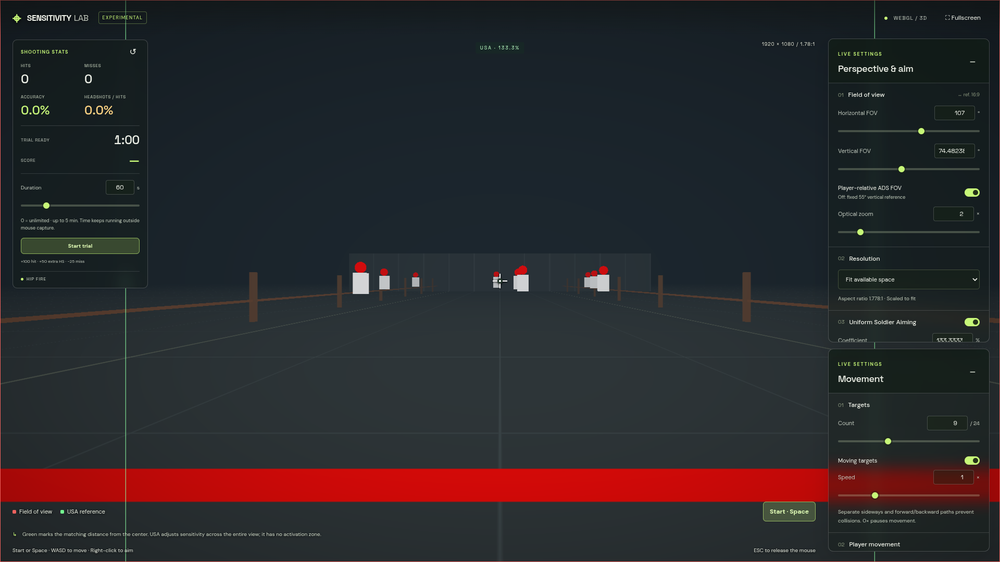
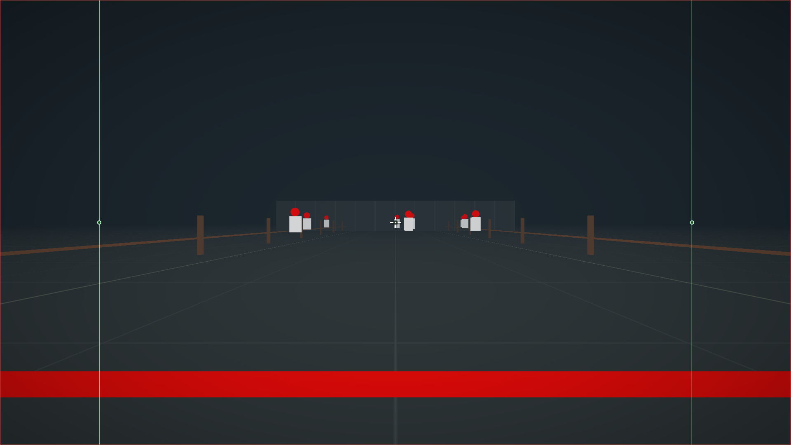

# Sensitivity Lab

Find an aiming setup that feels right. Adjust your field of view, zoom, sensitivity, and Uniform Soldier Aiming (USA), then compare them in an interactive shooting range.

**[Open Sensitivity Lab →](https://iasdev.github.io/sensitivity-lab/)**

## General settings

Set an **FPS cap from 30 to 360**, with **120 FPS by default**, and check your current frame rate in the General overlay. The cap is a maximum; achievable FPS depends on your display and device.

## Tune your aim

- Adjust horizontal or vertical FOV with sliders or precise numeric inputs.
- Try different resolutions and aspect ratios, including ultrawide, custom sizes, and fullscreen.
- Change optical zoom from 1× to 8× and choose whether aiming FOV follows your player FOV.
- Set mouse sensitivity from 0 to 200 and compare the displayed cm/360° at 800, 1600, and 3200 DPI.
- Enable or disable USA, adjust its coefficient from 0% to 300%, or use the center, 4:3, 16:9, and 21:9 presets.
- See the USA reference distance in green. Turn on **Outlines only** to keep the borders while seeing the scene without colored fills.

USA lets you compare how aiming feels at different zoom levels. Its green reference marks a matching distance from the center; sensitivity applies across the whole view. Try small corrections and wider flicks to find the coefficient that suits you.

## Build your practice session

Use **Movement** to choose between 1 and 24 targets, pause or enable their movement, and adjust their speed. Scale target bodies and heads together from **0.25× to 2×** using Size. Targets move sideways and forward/backward on separate paths without colliding.

Adjust your own movement speed and practice while strafing. The thick red firing line marks the limit: you can move around behind it, but cannot cross into the target area.

By default, each hit removes its target from the range. Turn off **Disappear on hit** in Movement to keep targets visible and hittable; any hidden targets return immediately. It respawns after **5 seconds by default**; adjust **Respawn delay** in Movement from **0.1 to 30 seconds**. Respawns keep counting while target movement is paused or the mouse is released. Delay changes apply to new hits, and starting a new trial restores all targets.

Shots fire once per click with a **250 ms minimum interval by default** (up to four shots per second). Adjust **Minimum shot interval** in Perspective & aim from **50 to 5000 ms** to simulate faster pistols or slower sniper rifles. Faster clicks are ignored and holding the button does not fire automatically.

Targets have white bodies and red heads. Body hits show a white hitmarker; headshots show a red one. Each has a distinct hit sound, while misses stay silent.

## Measure your results

The left overlay tracks hits, misses, accuracy, and headshots as a percentage of hits.

Start a timed trial to reset the counters and compare your results between settings:

- **60 seconds by default**, adjustable up to 5 minutes.
- Set duration to **0** for unlimited practice.
- Earn **100 points per hit**, plus **50 extra for a headshot**. Each miss subtracts **25 points**; the score never drops below zero.
- Time keeps running when you release the mouse. When a timed trial ends, your result stays visible for review.
- For an unlimited trial, release the mouse and select **Finish trial**.

For useful comparisons, keep the duration, target count, and movement speeds the same. Change one aiming setting at a time and compare accuracy, headshot rate, and score over several trials.

## Controls

| Action | Control |
| --- | --- |
| Start or stop mouse capture | **Space** or **Start / Stop** |
| Release the mouse | **Esc** |
| Look around | Move the mouse while captured |
| Move | **W / A / S / D** while captured |
| Aim | Hold the **right mouse button** |
| Shoot | **Left-click** while captured |
| Increase / decrease zoom | Scroll **up / down** over the scene |

The **Perspective & aim** and **Movement** menus collapse independently. Your settings are saved in your browser so you can resume later; statistics and trial results start fresh. Use **Reset settings** to return to the defaults.

## USA reference

Battlefield's [Uniform Soldier Aiming explanation](https://forums.ea.com/blog/battlefield-game-info-hub-en/dev-notes---uniform-soldier-aiming/7013669) was used as a reference for USA.

---

Made by Codex & iasdev with love
